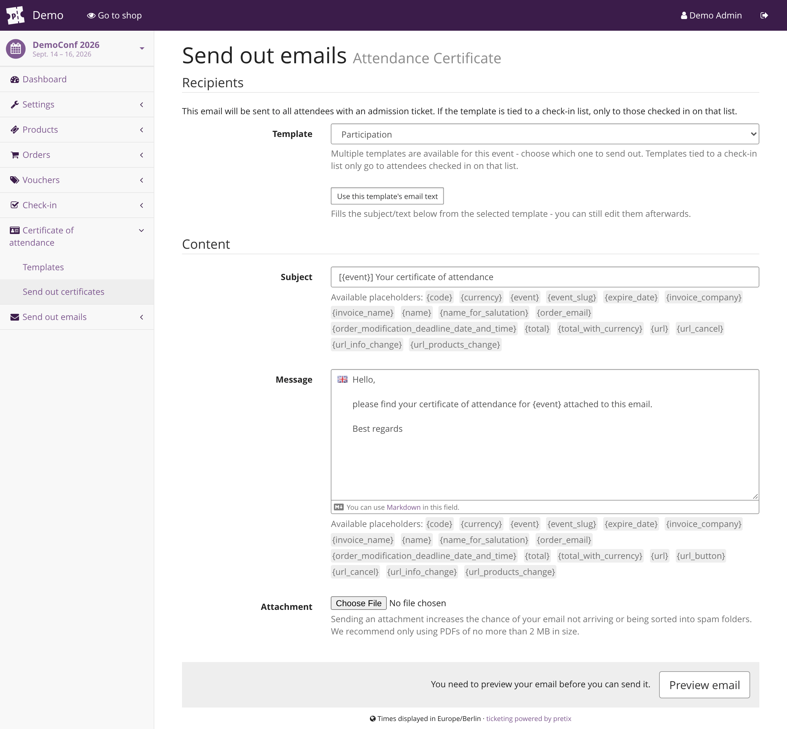
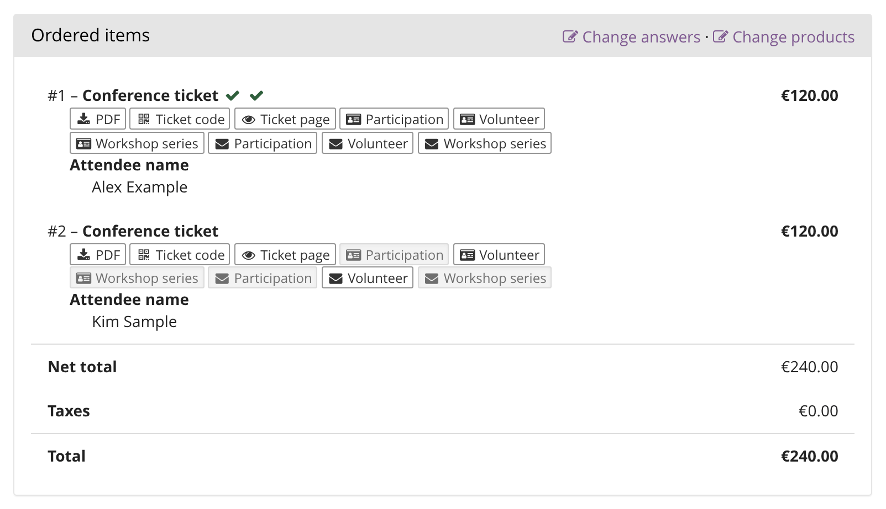
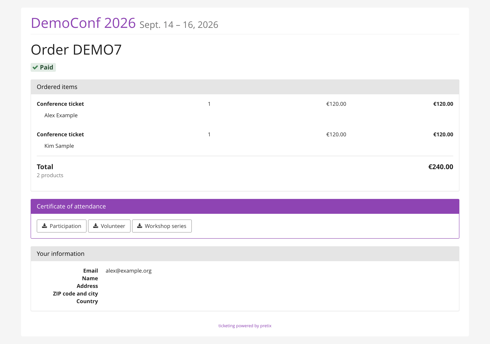
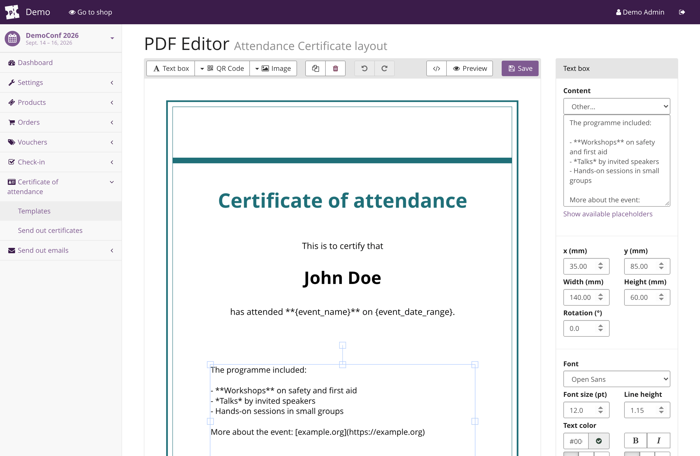
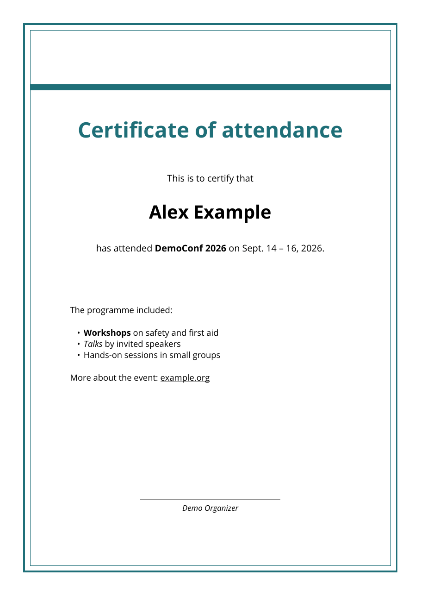
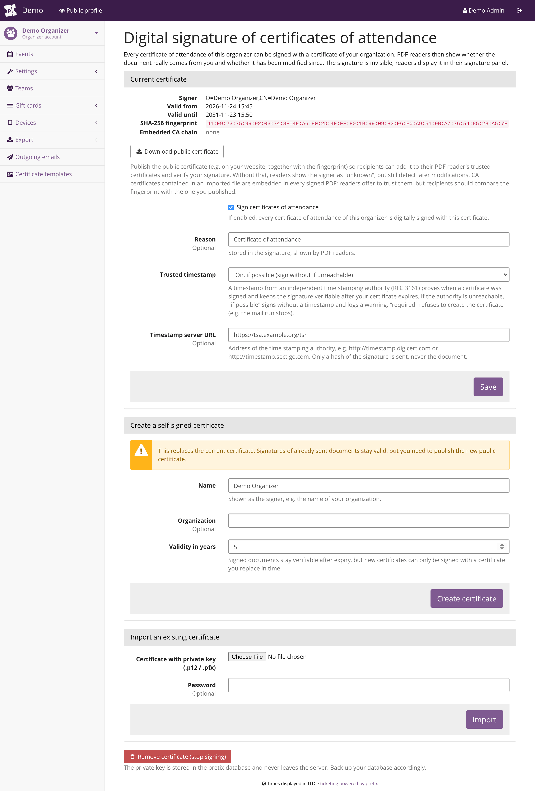

# pretix-attendance-certificate-neo

Plugin for [pretix](https://github.com/pretix/pretix) to create and send the
certificate of attendance to attendees.

This is a fork of
[pythonitalia/pretix-plugin-attendance-certificate](https://github.com/pythonitalia/pretix-plugin-attendance-certificate),
the plugin used by https://pycon.it. It uses its own Python package
(`pretix_attendance_certificate_neo`), so it can be installed next to the
original plugin; data of the original plugin is not taken over.

## Requirements

pretix 2026.7.0 or newer and Python 3.11 or newer.

## Templates

Templates either belong to one event or are managed organizer-wide (*Certificate
templates* in the organizer settings) and activated per event. A template can be
tied to a check-in list, so only attendees checked in on that list are eligible
for it; attendees can be eligible for several templates.

## Sending certificates

*Send out certificates* emails a template's certificate to all attendees with an
admission ticket (for a template tied to a check-in list, only to those checked
in on it). Subject and text can be filled from the template's own email text.

In the order details, every attendee gets buttons to download or email each
template; templates the attendee is not eligible for are greyed out.

## Self-service download

Optionally attendees can download their certificates from their order page:
only for paid orders, after the event is over, and only for attendees who were
checked in (on the template's check-in list, if it is tied to one).

## Formatting in the certificate text

The free text of the text fields in the layout editor ("Other…" and "Other…
(multilingual)") is Markdown: paragraphs (separated by a blank line), headings
(`# Title`), bullet (`- item`) and numbered (`1. item`) lists with nesting (four
spaces), block quotes (`> text`), code, horizontal rules (`---`), `**bold**`,
`*italic*`, `++underline++`, `` `code` `` and links (`[text](https://example.org)`; only http,
https, mailto and tel). Images are shown as their alt text, HTML is printed as
typed. The formatting comes from the template text only: placeholders such as
`{attendee_name}` are replaced afterwards and never interpreted as Markdown. The
editor canvas still shows the raw text, the preview PDF shows the result. Code
is set in a monospace font provided by pretix (a font family with "Mono",
"Courier" or "Code" in its name, e.g. from a font plugin) if there is one, and in
the font of the field otherwise.

The resulting certificate:

## Digital signature

Organizers can sign all certificates of attendance with a certificate of their
organization (PAdES signature, added with [pyHanko](https://github.com/MatthiasValvekens/pyHanko)).
Open *Certificate templates* in the organizer settings and choose
*Digital signature*; there you can create a self-signed certificate or import a
`.p12`/`.pfx` file.

With a self-signed certificate, PDF readers show the signer as unknown until the
public certificate (downloadable on the same page) is added to their trusted
certificates. Publish it together with its SHA-256 fingerprint, e.g. on your
website. Later modifications of a signed PDF are detected regardless.

CA certificates (e.g. the root) contained in an imported `.p12` are stored and
embedded in every signature. Readers still trust only a root the recipient has
imported themselves.

Optionally every signature gets a trusted timestamp (RFC 3161) from a timestamp
server of your choice, which keeps it verifiable after your certificate has
expired. Choose what happens if the server is unreachable: *if possible* signs
without a timestamp and logs a warning, *required* refuses to create the
certificate (a running mail send stops). A server that failed is skipped for
60 seconds, so a bulk send doesn't wait for timeouts on every PDF. This is
shared between all pretix processes if pretix has a cache configured (Redis or
memcached) and remembered per process otherwise.

The private key is stored unencrypted in the pretix database.

## Development setup

1. Make sure that you have a working
   [pretix development setup](https://docs.pretix.eu/en/latest/development/setup.html).
2. Clone this repository.
3. Activate the virtual environment you use for pretix development.
4. Execute `pip install -e .` within this directory to register this
   application with pretix's plugin registry.
5. Execute `make` within this directory to compile translations.
6. Restart your local pretix server. You can now use the plugin from this
   repository for your events by enabling it in the 'plugins' tab in the
   settings.

This plugin has CI set up to enforce a few code style rules with
[Ruff](https://docs.astral.sh/ruff/). To check your plugin for rule violations,
run:

    ruff format --check .
    ruff check .

You can auto-fix most of these issues by running:

    ruff format .
    ruff check --fix .

To automatically check for these issues before you commit, you can run
`.install-hooks.sh`.

Commits in this repository follow
[Conventional Commits](https://www.conventionalcommits.org/) and releases are
cut with [Commitizen](https://commitizen-tools.github.io/commitizen/)
(`cz bump`), which updates the version in `pyproject.toml` and
`pretix_attendance_certificate_neo/__init__.py`, writes `CHANGELOG.md` and
creates the matching git tag.

## Quick start without a pretix checkout

To run the tests and the style checks you do not need a full pretix development
setup. With [uv](https://docs.astral.sh/uv/), a few commands create a throwaway
environment that contains the plugin and pretix from its git master branch:

    uv venv
    source .venv/bin/activate
    uv pip install -e . --group dev --group test
    make
    pytest tests
    ruff check .

`make` needs GNU gettext (Debian package `gettext`). To try the plugin in a
running pretix, use the development setup above instead.

## License

Copyright (c) 2022 Python Italia, Copyright (c) 2026 et15

Released under the terms of the MIT License, see `LICENSE`.
